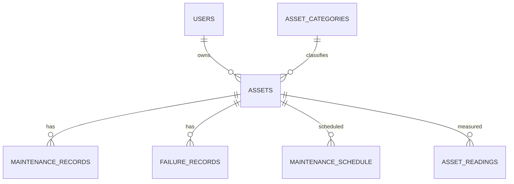

# ER Diagram

## Relational schema

`USERS(user_id PK, name, email UQ, password, created_at)`  
`ASSET_CATEGORIES(category_id PK, category_name UQ)`  
`ASSETS(asset_id PK, user_id FK, category_id FK, asset_name, asset_tag UQ, manufacturer, model, purchase_date, warranty_expiry, location, status, criticality, installation_date, created_at)`  
`MAINTENANCE_RECORDS(maintenance_id PK, asset_id FK, maintenance_type, maintenance_date, description, technician, cost, downtime_hours, status, created_at)`  
`FAILURE_RECORDS(failure_id PK, asset_id FK, failure_date, failure_type, severity, downtime_hours, repair_cost, description)`  
`MAINTENANCE_SCHEDULE(schedule_id PK, asset_id FK, scheduled_date, maintenance_type, notes, status)`  
`ASSET_READINGS(reading_id PK, asset_id FK, reading_date, cpu_usage, memory_usage, temperature, disk_usage, uptime_hours, error_count)`  
`DELETED_ASSET_LOG(log_id PK, asset_id, asset_tag, deleted_at)`
